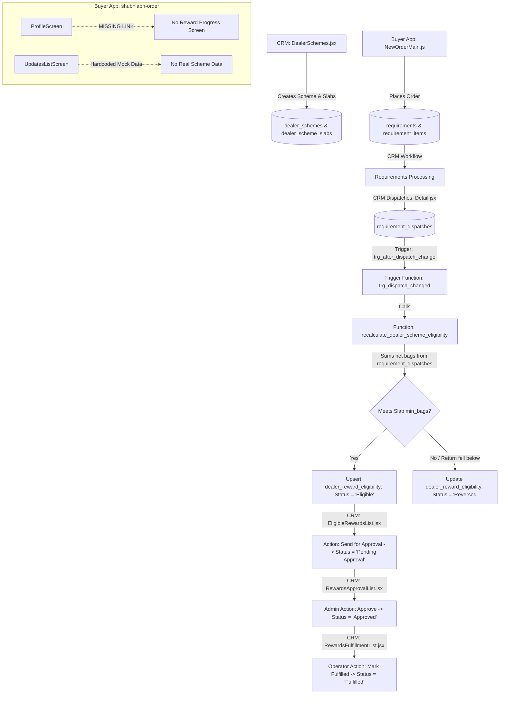

# SL-REWARD-CROSS-PROJECT-AUDIT-01: COMPREHENSIVE REWARD SCHEME AUDIT REPORT

**Date:** 2026-10-11  
**Audit Mode:** READ-ONLY AUDIT (Zero application code or database changes executed)  
**Target Repository:** `Nileshmnit08/ShubhlabhCRM` (`d:\ShubhLabhCRM`)  
**Target Projects:**
1. Shubh Labh CRM Web Application (`d:\ShubhLabhCRM\app`)
2. Shubh Labh Buyer App (`d:\ShubhLabhCRM\shubhlabh-order`)
3. Supabase Backend (`https://fwkjddflpzkowlawkmka.supabase.co`)

---

## A. EXECUTIVE SUMMARY

An extensive cross-project audit was performed to locate and inventory all preexisting reward-scheme, incentive, milestone, and loyalty code across the CRM Web Application, Buyer Mobile App, and Supabase database.

### Key Audit Findings:
1. **Preexisting Backend Reward Architecture:**  
   A substantial reward and scheme infrastructure **already exists and is deployed in the live database**. It was designed across migrations `72_sprint_17_6_dealer_schemes.sql`, `96_sprint_23_dealer_growth_hub.sql`, `97_sprint_24_bag_based_rewards.sql`, `98_fix_dealer_scheme_slabs_rls.sql`, `99_fix_dealer_growth_hub_backend.sql`, `100_sprint_25_customer_scheme_growth_hub.sql`, `101_fix_customer_scheme_performance_rpc.sql`, `102_dispatch_tracking_schema.sql`, `103_update_scheme_performance_rpc.sql`, and `104_dispatch_based_reward_triggers.sql`.
   
2. **CRM Functionality Status: OPERATIONAL IN BACKEND & CRM UI:**  
   The CRM already has working interfaces:
   - **Scheme & Slab Configuration:** `app/src/pages/Settings/DealerSchemes.jsx` allows admins to create/edit schemes (`dealer_schemes`) and tiered milestone slabs (`dealer_scheme_slabs`) with min/max bag targets, physical gifts, and points.
   - **Growth Hub & Review Dashboard:** `app/src/pages/DealerGrowthHub/` runs automated performance calculations via RPC `get_customer_scheme_performance()`, and contains operational workflows for:
     - Sending eligible rewards for approval (`EligibleRewardsList.jsx`)
     - Admin approval and rejection (`RewardsApprovalList.jsx`)
     - Marking physical gift fulfillment with notes and dates (`RewardsFulfillmentList.jsx`)

3. **Buyer App Status: ZERO REAL REWARD IMPLEMENTATION (MOCK ONLY):**  
   The Buyer App (`shubhlabh-order`) currently has **no real reward scheme integration**:
   - `shubhlabh-order/src/features/updates/UpdatesListScreen.js` displays hardcoded mock data (`Diwali Mega Offer`).
   - `shubhlabh-order/src/features/businessUpdates/BusinessUpdatesListScreen.js` supports generic broadcast announcements from `business_updates`, with `'Scheme'` and `'Reward'` merely listed in a client-side filter array.
   - `shubhlabh-order/src/features/profile/ProfileScreen.js` does not contain any link or screen for "My Reward Schemes".
   - `MeriOrderListScreen.js` contains a commented hardcoded placeholder (`Scheme Benefit: - ₹0`).

4. **Single Source of Truth for Orders vs. Duplicate Tables:**  
   The canonical Single Source of Truth (SSOT) established across the CRM and Buyer App is:
   - Order Header: `public.requirements` (Customer: `requirements.party_id` -> `crm_parties.id`)
   - Order Line Items: `public.requirement_items` (Single source of truth for products, quantities, weights, gifts)
   - Dispatches: `public.requirement_dispatches` (Linked via `requirement_id` to `requirements.id`)
   - Parallel/Abandoned tables found: `public.sales_invoices` and `public.sales_invoice_line_items` (created in Sprint 24, now abandoned/empty), as well as `public.buyer_orders` and `public.buyer_order_items` (created in an older experimental order sprint, now abandoned/empty).

5. **Critical Logic & Business Rule Inconsistencies:**  
   - **Line-Item Product/Category Filtering Missing:** Although `dealer_schemes` contains `product_eligibility`, the active recalculation function `recalculate_dealer_scheme_eligibility` (migration 104) sums total bags from `requirement_dispatches` at the header level. Because `requirement_dispatches` does not record which line-item products were dispatched, it blindly counts all dispatched bags regardless of product eligibility.
   - **Silent Reversal of Approved Rewards:** In migration 104, if a return causes bag count to drop below a slab, the trigger automatically executes `UPDATE dealer_reward_eligibility SET status = 'Reversed'` even if the reward was already `'Approved'`. This directly violates the business rule requiring CRM approval before reversing an approved reward.
   - **Grace Period & Earning Period Separation Missing:** No database columns or logic currently exist for the 7-day grace period, late dispatch synchronization, or closure reconciliation.
   - **Tonnage Measurement Missing:** The current calculation strictly treats dispatch quantities as bags, ignoring tonnage schemes and unit conversion factors.

6. **Critical Security & RLS Risks Identified:**  
   - `dealer_scheme_slabs`: Migration `98_fix_dealer_scheme_slabs_rls.sql` granted `ALL` (INSERT, UPDATE, DELETE) to any authenticated user without role gating (`TO authenticated USING (true) WITH CHECK (true)`). A compromised buyer session can tamper with reward slabs.
   - `dealer_reward_eligibility`, `dealer_targets`, `dealer_reward_ledger`, `dealer_reward_claims`: RLS was never enabled in migration DDL. Anonymous and untrusted users can read reward records over REST.
   - `dealer_schemes`: `Allow all on dealer_schemes` policy allows unrestricted access (`USING (true) WITH CHECK (true)`).

---

## B. PROJECT AND ENVIRONMENT MAP

| Parameter | Shubh Labh CRM | Shubh Labh Buyer App | Field Assistant (Reference) |
|---|---|---|---|
| **Filesystem Path** | `d:\ShubhLabhCRM\app` | `d:\ShubhLabhCRM\shubhlabh-order` | `d:\ShubhLabhCRM\mobile` / `mobileFieldStaff` |
| **Repository** | `https://github.com/Nileshmnit08/ShubhlabhCRM` | Same Monorepo | Same Monorepo |
| **Current Branch** | `main` | `main` | `main` |
| **Current Commit** | `10f17e5 Fix order single source of truth` | `10f17e5` | `10f17e5` |
| **Technology Stack** | React 18, Vite, Lucide | Expo SDK 57, React Native 0.86, React Navigation | Expo SDK 57, React Native 0.86 |
| **Supabase Project URL** | `https://fwkjddflpzkowlawkmka.supabase.co` | `https://fwkjddflpzkowlawkmka.supabase.co` | `https://fwkjddflpzkowlawkmka.supabase.co` |
| **Supabase Project Ref** | `fwkjddflpzkowlawkmka` | `fwkjddflpzkowlawkmka` | `fwkjddflpzkowlawkmka` |
| **Database Pooler** | `aws-0-ap-south-1.pooler.supabase.com:6543` | Same | Same |
| **Database Sharing** | **CONFIRMED SHARED** | **CONFIRMED SHARED** | **CONFIRMED SHARED** |
| **Buyer Role Identifier** | Handled via `app_users.role = 'Buyer'` | Logged in as `app_users.role = 'Buyer'` | `app_users.role = 'Field Staff'` |
| **Customer Linkage** | `crm_parties.id` | `app_users.crm_party_id` -> `crm_parties.id` | Staff assigned via `assigned_owner_id` |
| **Working Tree Status** | Clean (uncommitted files restricted to scratch/diagnostic files) | Clean | Clean |

---

## C. EXISTING DATABASE OBJECT INVENTORY

Every reward, scheme, order, and dispatch database object was inspected directly via migration source files and verified against the deployed Supabase database (`fwkjddflpzkowlawkmka`).

| Object Name | Schema / Type | Creation Migration | Used By | Classification | Purpose & Live Status |
|---|---|---|---|---|---|
| `public.dealer_schemes` | Table | `72_sprint_17_6_dealer_schemes.sql`, updated in `97`, `100` | CRM `DealerSchemes.jsx`, `DealerGrowthHub` | **CANONICAL** | Primary scheme definition table (name, start_date, end_date, status, customer_type, overlap_policy, product_eligibility). Live DB has 3 rows. |
| `public.dealer_scheme_slabs` | Table | `96_sprint_23_dealer_growth_hub.sql`, updated in `97` | CRM `DealerSchemes.jsx`, `DealerGrowthHub` | **CANONICAL** | Milestone reward tiers (scheme_id, slab_name, min_bags, max_bags, reward_type, reward_value, reward_description). Live DB verified. |
| `public.dealer_reward_eligibility` | Table | `97_sprint_24_bag_based_rewards.sql`, updated in `104` | Trigger `trg_after_dispatch_change`, CRM `DealerGrowthHub` | **CANONICAL** | Customer reward achievement ledger (customer_id, scheme_id, slab_id, qualifying_bags, status, approved_by, approved_at, fulfilled_by, fulfilled_at, fulfillment_notes). Unique constraint on `(customer_id, scheme_id, slab_id)`. Live DB verified. |
| `public.dealer_reward_calculation_audit` | Table | `97_sprint_24_bag_based_rewards.sql` | Trigger `recalculate_dealer_scheme_eligibility` | **CANONICAL** | Audit trail recording customer_id, scheme_id, old_bag_total, new_bag_total, trigger_event. Live DB verified. |
| `public.dealer_scheme_participations` | Table | `72_sprint_17_6_dealer_schemes.sql` | View `v_dealer_growth_hub` | **LEGACY / UNUSED** | Created in Sprint 17 for manual scheme enrollments. Not utilized by automated dispatch engine. |
| `public.dealer_targets` | Table | `96_sprint_23_dealer_growth_hub.sql` | CRM `TargetClosingAlerts.jsx` | **AUXILIARY** | Manual currency-value dealer sales targets (target_value, achievement_value). Distinct from bag milestone slabs. |
| `public.dealer_target_revisions` | Table | `96_sprint_23_dealer_growth_hub.sql` | CRM Targets | **AUXILIARY** | Audit log for revisions to manual monetary targets. |
| `public.dealer_target_alerts` | Table | `96_sprint_23_dealer_growth_hub.sql` | CRM Targets | **AUXILIARY** | Alert queue for monetary targets nearing deadlines. |
| `public.dealer_reward_ledger` | Table | `96_sprint_23_dealer_growth_hub.sql` | View `v_dealer_growth_hub` | **SUPERSEDED** | Generic points ledger (points, transaction_type). Bypassed in Sprint 24/25 in favor of `dealer_reward_eligibility`. Currently 0 rows. |
| `public.dealer_reward_claims` | Table | `96_sprint_23_dealer_growth_hub.sql` | View `v_dealer_growth_hub` | **SUPERSEDED** | Points claims queue. Replaced by `dealer_reward_eligibility` approval/fulfillment lifecycle. |
| `public.dealer_communications` | Table | `96_sprint_23_dealer_growth_hub.sql` | CRM Dealer Comms | **AUXILIARY** | Logs WhatsApp communications to dealers about schemes and targets. |
| `public.dealer_followups` | Table | `96_sprint_23_dealer_growth_hub.sql` | CRM Dealer Growth | **AUXILIARY** | CRM task follow-ups tied to scheme closing dates. |
| `public.dealer_program_audit_logs` | Table | `96_sprint_23_dealer_growth_hub.sql` | CRM Audit | **AUXILIARY** | Audit log for dealer scheme configuration edits. |
| `public.sales_invoices` | Table | `97_sprint_24_bag_based_rewards.sql` | RPC `get_customer_scheme_performance` (historical pace) | **DUPLICATE / ABANDONED** | Created in Sprint 24 for invoice-based calculation. Dispatches replaced it in Sprint 25. Currently 0 rows in live database. |
| `public.sales_invoice_line_items` | Table | `97_sprint_24_bag_based_rewards.sql` | None (trigger dropped in 104) | **DUPLICATE / ABANDONED** | Created in Sprint 24. Live DB empty. Bypassed by `requirement_dispatches`. |
| `public.requirements` | Table | `01_sprint_1_schema.sql`, `SL-ORDER-SSOT-FIX-01` | CRM & Buyer App | **CANONICAL** | Order header table. Contains `party_id` (FK to `crm_parties.id`), `demand_ref`, `status`, `created_at`. Live DB verified. |
| `public.requirement_items` | Table | `01_sprint_1_schema.sql`, `SL-ORDER-SSOT-FIX-01` | CRM & Buyer App | **CANONICAL** | Order line items. Single source of truth for `product_name`, `category`, `quantity`, `unit`, `weight`, `gift`. |
| `public.requirement_dispatches` | Table | `102_dispatch_tracking_schema.sql` | CRM Dispatches & Trigger | **CANONICAL** | Order dispatch records (quantity, unit, dispatch_date, status, return_quantity, shortage_quantity). Live DB verified (contains records). |
| `public.v_requirement_dispatch_summary` | View | `102_dispatch_tracking_schema.sql` | CRM Dispatches | **CANONICAL** | Computes total dispatched, pending quantity, latest truck/driver per requirement. |
| `public.buyer_orders` / `items` | Tables | `SL-ORDER-06-buyer-orders.sql` | Abandoned | **DUPLICATE / ABANDONED** | Parallel order tables created during prior experiments. Deprecated by `SL-ORDER-SSOT-FIX-01` in favor of `requirements`. Live DB empty. |
| `public.get_customer_scheme_performance` | SQL RPC | `100`, updated in `101`, `103` | CRM `DealerGrowthHub/index.jsx` | **CANONICAL** | Server-side RPC calculating customer net bags, pace, achieved slabs, next slabs, and days remaining. Live DB verified (returns HTTP 200, 64 rows). |
| `public.recalculate_dealer_scheme_eligibility` | SQL Function | `97`, updated in `104` | Trigger `trg_after_dispatch_change` | **CANONICAL** | Recalculates customer qualifying bags from `requirement_dispatches` and updates `dealer_reward_eligibility`. |
| `public.trg_after_dispatch_change` | SQL Trigger | `104_dispatch_based_reward_triggers.sql` | Automatic Backend Event | **CANONICAL** | Executes after INSERT, UPDATE, DELETE on `requirement_dispatches` to trigger reward recalculation. |
| `public.business_updates` / `recipients` | Tables | `229_sprint_COMM_01_business_updates.sql` | CRM & Buyer App Updates | **CANONICAL** | Durable in-app broadcast and notification infrastructure with customer-specific read tracking. |
| `public.user_push_tokens` | Table | `222_sprint_FCM_PUSH_TOKENS.sql` | Edge Function `send-fcm-notification` | **CANONICAL** | Stores FCM device tokens for authenticated users with role isolation. |

---

## D. EXISTING FEATURE MATRIX

| Feature Area | Sub-feature | Project / Location | Database Dependency | Current Status | Concrete Evidence | Missing Work / Gaps |
|---|---|---|---|---|---|---|
| **Scheme Config** | Create & Edit Schemes | CRM: `DealerSchemes.jsx` | `dealer_schemes` | IMPLEMENTED AND VERIFIED | Reads/writes name, dates, description, status, overlap_policy, customer_type. | Product/category selection UI is missing; grace period duration input missing. |
| **Scheme Config** | Milestone Slabs | CRM: `DealerSchemes.jsx` | `dealer_scheme_slabs` | IMPLEMENTED AND VERIFIED | Dynamic slab creation, validation of strictly increasing `min_bags`, reward description/value. | Repeatable milestone options missing; non-bag measurement missing. |
| **Eligibility** | Product & Category Filtering | Backend: `recalculate_dealer_scheme_eligibility` | `dealer_schemes.product_eligibility` | NOT FOUND | Migration 104 sums raw dispatch quantity without joining `requirement_items` or filtering products. | Junction table `scheme_eligible_products` and line-item dispatch attribution missing. |
| **Eligibility** | Bag vs Tonnage Separation | Backend: `recalculate_dealer_scheme_eligibility` | `requirement_dispatches.unit` | NOT FOUND | Trigger treats `quantity` as bags regardless of unit. | Separate tonnage calculation rules, unit validation, and conversion handling missing. |
| **Order Flow** | Placement & Modification | Buyer App: `OrderService.js`, `MeriOrderListScreen.js` | `requirements`, `requirement_items` | IMPLEMENTED AND VERIFIED | Normalizes `requirement_items` with category, quantity, weight, gift. | Linkage between line items and subsequent dispatches missing. |
| **Dispatch Flow** | Dispatch Recording & Returns | CRM: `Dispatches/Detail.jsx` | `requirement_dispatches` | IMPLEMENTED AND VERIFIED | Records delivery date, shortages, cancellations, and return quantities. | No line-item selection when recording partial dispatches across multiple items. |
| **Progress Engine** | Automatic Recalculation | Supabase: `trg_after_dispatch_change` | `requirement_dispatches` | IMPLEMENTED AND VERIFIED | Live trigger automatically recalculates customer bags and updates `dealer_reward_eligibility`. | Calculates at requirement header level instead of eligible line-item level. |
| **Progress Engine** | Performance RPC | Supabase: `get_customer_scheme_performance()` | `dealer_schemes`, `requirements`, `requirement_dispatches` | IMPLEMENTED AND VERIFIED | Live RPC tested successfully (HTTP 200, 64 customer records returned). | References obsolete `sales_invoices` for historical pacing calculations. |
| **Buyer UI** | Reward Progress Screen | Buyer App: `src/features/` | None | NOT FOUND | Search yielded 0 reward progress screens in Buyer App navigation or Profile. | Full "My Reward Schemes" screen, progress bar, milestone track, and history missing. |
| **Buyer UI** | Schemes Banner / Announcements | Buyer App: `UpdatesListScreen.js` | None (Mock) | UI ONLY / MOCK DATA | Displays static hardcoded array (`Diwali Mega Offer`). | Needs connection to canonical `dealer_schemes` or `business_updates`. |
| **Lifecycle** | Milestone Achievement | Supabase: `recalculate_dealer_scheme_eligibility` | `dealer_reward_eligibility` | IMPLEMENTED AND VERIFIED | Automatically sets status to `'Eligible'` upon meeting `min_bags`. | Does not emit a notification event to the buyer. |
| **Lifecycle** | CRM Review & Approval | CRM: `DealerGrowthHub/components/Lists/RewardsApprovalList.jsx` | `dealer_reward_eligibility` | IMPLEMENTED AND VERIFIED | Admin can review achieved quantities and approve or reject. | Rejection stores reason in notes, but has no dedicated reversal review case queue. |
| **Lifecycle** | Gift Fulfilment | CRM: `DealerGrowthHub/components/Lists/RewardsFulfillmentList.jsx` | `dealer_reward_eligibility` | IMPLEMENTED AND VERIFIED | Operator enters delivery date and reference notes; status transitions to `'Fulfilled'`. | No buyer confirmation or receipt upload. |
| **Lifecycle** | Reversals on Returns | Supabase: `trg_after_dispatch_change` | `dealer_reward_eligibility` | PARTIALLY IMPLEMENTED (Violates Rule) | Trigger forces `status = 'Reversed'` on 'Approved' rewards automatically. | Violates requirement that reversals require explicit CRM review/approval. |
| **Lifecycle** | Grace Period & Late Sync | Backend / CRM / Buyer App | None | NOT FOUND | Code contains 0 references to 7-day grace period logic for schemes. | Grace period calculation, late sync acceptance window, and closure blocking missing. |
| **Lifecycle** | Scheme Closure Reconciliation | CRM: `DealerSchemes.jsx` | `dealer_schemes.status` | PARTIALLY IMPLEMENTED | Status can be changed to 'Closed' in a dropdown. | No reconciliation check, no verification of pending rewards, no audit snapshot. |
| **Notifications** | Milestone Alerts & Updates | Backend / App: `business_updates`, `user_push_tokens` | `business_updates`, `user_push_tokens` | PARTIALLY IMPLEMENTED | Push infrastructure and in-app update schemas exist, but scheme triggers are not wired. | Automatic notification generation upon milestone qualification is missing. |

---

## E. END-TO-END LIFECYCLE MAP

The current implemented path from scheme configuration to fulfillment operates as follows:



### Stage-by-Stage Verification:

1. **Scheme Creation & Configuration:** **IMPLEMENTED AND VERIFIED** (`DealerSchemes.jsx` -> `dealer_schemes`, `dealer_scheme_slabs`).
2. **Product / Category Selection:** **NOT FOUND / UI ONLY** (`product_eligibility` column exists, but no UI or junction table exists).
3. **Bag vs Tonnage Rules:** **PARTIALLY IMPLEMENTED** (Bag thresholds exist in slabs; tonnage logic is absent).
4. **Target / Milestone Setup:** **IMPLEMENTED AND VERIFIED** (`dealer_scheme_slabs`).
5. **Order Placement:** **IMPLEMENTED AND VERIFIED** (`requirements`, `requirement_items`).
6. **Order Processing:** **IMPLEMENTED AND VERIFIED** (`requirements.status`).
7. **Dispatch Recording:** **IMPLEMENTED AND VERIFIED** (`requirement_dispatches`).
8. **Calculation of Eligible Dispatched Quantities:** **PARTIALLY IMPLEMENTED** (Calculates total dispatched requirement bags; lacks line-item product filtering).
9. **Buyer App Progress Display:** **NOT FOUND** (Profile navigation lacks reward screens; mock data in Updates screen).
10. **Milestone Qualification:** **IMPLEMENTED AND VERIFIED** (`dealer_reward_eligibility.status = 'Eligible'`).
11. **Reward Notification:** **PARTIALLY IMPLEMENTED** (Push and in-app update schemas exist; milestone trigger is not wired).
12. **CRM Review and Approval:** **IMPLEMENTED AND VERIFIED** (`RewardsApprovalList.jsx`).
13. **Gift Fulfilment:** **IMPLEMENTED AND VERIFIED** (`RewardsFulfillmentList.jsx`).
14. **Returns and Reversals:** **PARTIALLY IMPLEMENTED** (Trigger recalculates, but violates business rule by silently reversing approved rewards).
15. **Grace Period & Late Sync:** **NOT FOUND** (No code or schema exists).
16. **Scheme Closure Reconciliation:** **PARTIALLY IMPLEMENTED** (Status flag exists, but no reconciliation or checks exist).

---

## F. DUPLICATION AND CONFLICT REGISTER

### 1. `public.sales_invoices` vs `public.requirements` / `requirement_dispatches`
- **Object A:** `sales_invoices` and `sales_invoice_line_items` (Migration `97_sprint_24_bag_based_rewards.sql`).
- **Object B:** `requirements`, `requirement_items`, and `requirement_dispatches` (Migrations `01`, `102`, `SL-ORDER-SSOT-FIX-01.sql`).
- **Evidence of Overlap:** Both models attempt to track customer purchases, products, quantities, and returns for reward progress. Migration 103 and 104 explicitly shifted calculation from `sales_invoices` to `requirement_dispatches`.
- **Verdict:** **CONFIRMED DUPLICATE / DEAD CODE.** `sales_invoices` and its line items contain 0 records in the live database and have no active write triggers.
- **Data Risk:** `get_customer_scheme_performance()` still attempts a `LEFT JOIN sales_invoices` for 3-month historical pacing calculations, which will fail or yield zeros.
- **Recommended Resolution:** Treat `requirements` and `requirement_dispatches` as the canonical source. Refactor RPC 103 to drop references to `sales_invoices`.

### 2. `public.buyer_orders` vs `public.requirements`
- **Object A:** `buyer_orders` and `buyer_order_items` (Migration `SL-ORDER-06-buyer-orders.sql`).
- **Object B:** `requirements` and `requirement_items` (Canonical Monorepo SSOT).
- **Evidence of Overlap:** Both represent buyer orders with line items. `SL-ORDER-SSOT-FIX-01.sql` formally unified order management into `requirements` and backfilled weights/gifts into `requirement_items`.
- **Verdict:** **CONFIRMED DUPLICATE / ABANDONED.** Live DB tables are empty.
- **Data Risk:** Confuses developers inspecting the schema; risk of accidental parallel writes.
- **Recommended Resolution:** Do not use `buyer_orders`. Keep `requirements` and `requirement_items` as the sole canonical order ledger.

### 3. `public.dealer_reward_ledger` / `claims` vs `public.dealer_reward_eligibility`
- **Object A:** `dealer_reward_ledger` and `dealer_reward_claims` (Migration `96_sprint_23_dealer_growth_hub.sql`).
- **Object B:** `dealer_reward_eligibility` (Migrations `97_sprint_24`, `104`).
- **Evidence of Overlap:** Object A represents an abstract monetary points wallet (points earned, claimed, redeemed). Object B represents concrete slab qualification, approvals, and physical gift/reward fulfillments.
- **Verdict:** **SUPERSEDED ARCHITECTURAL PATTERN.** `dealer_reward_ledger` was designed for generic dealer points before bag-based slab rewards were introduced. The active CRM Growth Hub UI and database triggers exclusively read/write `dealer_reward_eligibility`.
- **Data Risk:** Writing points into `dealer_reward_ledger` while managing physical gifts in `dealer_reward_eligibility` would create desynchronized reward states.
- **Recommended Resolution:** Standardize on `dealer_reward_eligibility` as the canonical reward achievement and fulfillment ledger.

### 4. `public.dealer_schemes` vs Proposed Buyer Reward Schemes
- **Object A:** `public.dealer_schemes` (Preexisting).
- **Object B:** Any hypothetical new table (e.g. `buyer_schemes` or `reward_schemes`).
- **Evidence of Overlap:** `dealer_schemes` already supports customer type scoping (`customer_type VARCHAR(100)`), overlap policies, bag slabs, active/closed dates, and performance RPCs.
- **Verdict:** **PREVENT DUPLICATION.** Creating a separate table for buyers would violate the primary micro-sprint rule.
- **Recommended Resolution:** Reuse and extend `dealer_schemes` for both Dealers and Buyers.

---

## G. CANONICAL SOURCE-OF-TRUTH RECOMMENDATION

To satisfy the primary directive (**DO NOT CREATE DUPLICATE DATABASE TABLES OR PARALLEL REWARD SYSTEMS**), the following canonical objects are recommended:

1. **Scheme & Milestone Configuration:**
   - **Canonical Table:** `public.dealer_schemes`
   - **Canonical Slabs:** `public.dealer_scheme_slabs`
   - **Justification:** Fully integrated with CRM `DealerSchemes.jsx`, deployed on live Supabase with existing records, and linked to backend calculation RPCs.
   
2. **Customer & Buyer Identity:**
   - **Canonical Table:** `public.crm_parties` linked to `public.app_users` via `app_users.crm_party_id`.
   - **Justification:** Authenticated buyers in `shubhlabh-order` resolve `userProfile.crm_party_id` to `crm_parties.id`. Both CRM customer management and Field Staff use `crm_parties.id`.

3. **Authoritative Order & Line-Item Data:**
   - **Canonical Order Header:** `public.requirements` (`party_id` = `crm_parties.id`)
   - **Canonical Order Line Items:** `public.requirement_items` (`requirement_id` = `requirements.id`)
   - **Justification:** Formally certified as Single Source of Truth in `SL-ORDER-SSOT-FIX-01.sql` and implemented in Buyer App `OrderService.js`.

4. **Authoritative Dispatch & Return Data:**
   - **Canonical Dispatches:** `public.requirement_dispatches` (`requirement_id` = `requirements.id`)
   - **Justification:** Active operational table in CRM `Dispatches/Detail.jsx` containing actual dispatch dates, truck numbers, delivery status, shortage quantities, and return quantities.

5. **Authoritative Reward Progress & Lifecycle Ledger:**
   - **Canonical Ledger:** `public.dealer_reward_eligibility`
   - **Justification:** Driven by trigger `trg_after_dispatch_change`. Contains unique constraint `(customer_id, scheme_id, slab_id)`, tracking status (`Eligible`, `Pending Approval`, `Approved`, `Fulfilled`, `Reversed`), approver UUIDs, fulfiller UUIDs, and fulfillment notes. Fully integrated with CRM `DealerGrowthHub`.

6. **Authoritative In-App & Push Notifications:**
   - **In-App History:** `public.business_updates` and `public.business_update_recipients`
   - **Push Device Tokens:** `public.user_push_tokens` (Edge function `send-fcm-notification`)
   - **Justification:** Production-tested notification infrastructure with existing Buyer App RLS isolation and multidevice push capability.

---

## H. GAPS AND OPEN DECISIONS

### Genuine Missing Functionality:
1. **Line-Item Product Attribution on Dispatches:**
   `requirement_dispatches` currently records dispatches for the requirement as a whole. When an order contains multiple products (e.g. Feed vs Non-feed), there is no column or child table linking dispatched bags to specific `requirement_items`.
2. **Explicit Product / Category Selection in Scheme Configuration:**
   Neither `DealerSchemes.jsx` nor the database provides a mechanism to select specific eligible products/categories.
3. **Grace Period (7 Calendar Days):**
   There are no fields for `grace_period_days`, `earning_end_date`, or grace period validation. Dispatches synced after `end_date` are unconditionally excluded, even if dispatched within the earning period.
4. **Controlled Reversal Approval Queue:**
   When a return drops a buyer's net quantity below an approved milestone, migration 104 automatically changes `status = 'Reversed'`. There is no review queue for CRM approval before reversing.
5. **Buyer App Reward Screens:**
   No screens exist in `shubhlabh-order` to display active schemes, current dispatched bag progress, remaining bags to next slab, or reward history.
6. **Milestone Notification Wiring:**
   Qualification events in `dealer_reward_eligibility` do not trigger automated entries in `business_updates` or FCM push notifications.

### Open Business & Architectural Decisions Needed:
1. **Line-Item Dispatch Architecture:**  
   *Option A:* Add `requirement_item_id` (FK to `requirement_items`) to `requirement_dispatches` so dispatches are recorded per product line item.  
   *Option B:* Add a child table `requirement_dispatch_items (dispatch_id, requirement_item_id, quantity)`.  
   *Decision Required:* Confirm whether CRM dispatch entry should allow partial dispatch per line item.
2. **Product Eligibility Storage:**  
   *Option A:* Add a junction table `scheme_eligible_products (scheme_id, product_id)`.  
   *Option B:* Store an array of UUIDs `eligible_product_ids UUID[]` or `eligible_categories TEXT[]` on `dealer_schemes`.  
   *Decision Required:* Confirm preferred schema extension.
3. **Reversal Workflow Policy:**  
   Confirm exact status transition when a return impacts an approved reward: introduce status `'Under Review'` / `'Pending Reversal'` instead of direct `'Reversed'`.
4. **Repeatable Milestones:**  
   Confirm whether buyer schemes are strictly tiered slabs (e.g. 100 bags, 250 bags, 500 bags) or can have repeating targets (e.g. gift for every 50 bags).

---

## I. SECURITY AND DATA INTEGRITY FINDINGS

1. **Unrestricted Slabs Modification (Critical Risk):**
   In `98_fix_dealer_scheme_slabs_rls.sql`, policies allow any authenticated user to INSERT, UPDATE, and DELETE reward slabs:
   ```sql
   CREATE POLICY "Enable insert access for authenticated users on slabs" ON public.dealer_scheme_slabs FOR INSERT TO authenticated WITH CHECK (true);
   ```
   *Remediation Required:* Restrict INSERT, UPDATE, and DELETE on `dealer_scheme_slabs` to Admin roles (`is_admin()`), and allow authenticated users SELECT only.

2. **Unprotected Reward Records (Critical Risk):**
   `dealer_reward_eligibility`, `dealer_targets`, `dealer_reward_ledger`, and `dealer_reward_claims` do not have Row-Level Security enabled. REST queries with the anon key currently succeed with HTTP 200.
   *Remediation Required:* Enable RLS on all reward tables. Add buyer-isolated SELECT policies (`USING (customer_id = get_auth_crm_party_id())`).

3. **Broad Access on Dispatches:**
   `requirement_dispatches` has policy `Allow all on requirement_dispatches USING (true)`.
   *Remediation Required:* Restrict buyer SELECT to dispatches belonging to their requirements (`EXISTS (SELECT 1 FROM requirements r WHERE r.id = requirement_id AND r.party_id = get_auth_crm_party_id())`).

4. **Server-Side Calculation Integrity (Verified Positive):**
   Reward calculations are executed entirely within database triggers (`trg_after_dispatch_change` and `recalculate_dealer_scheme_eligibility`) and security-definer RPCs (`get_customer_scheme_performance()`). The Buyer App client cannot tamper with or submit self-calculated reward progress.

5. **Idempotency & Duplicate Prevention (Verified Positive):**
   `dealer_reward_eligibility` enforces `UNIQUE(customer_id, scheme_id, slab_id)` with `ON CONFLICT DO UPDATE`. Replaying identical dispatch events cannot award duplicate milestone records.

---

## J. PRIORITISED REMEDIATION PLAN (PROPOSAL ONLY)

The following safe sequence of micro-sprints is proposed, strictly reusing existing database objects and frontend structures:

### Sprint 02 — Functional Specification & Data Contract Confirmation
- **Objective:** Lock down the data contracts and open decisions before writing any code.
- **Scope:** Define exact JSON/field formats for eligible product selection, line-item dispatch attribution, 7-day grace period rules, and the reward reversal review status model.
- **Database/Code Changes:** None.

### Sprint 03 — Database Security Hardening & RLS Lockdown
- **Objective:** Secure existing reward tables and isolate buyer data without breaking CRM access.
- **Reused Objects:** `dealer_schemes`, `dealer_scheme_slabs`, `dealer_reward_eligibility`, `requirement_dispatches`.
- **Target Changes:** Enable RLS; restrict slab modification to Admins; add buyer-isolated SELECT policies using `get_auth_crm_party_id()`.

### Sprint 04 — Product Eligibility & Dispatch Line-Item Alignment
- **Objective:** Enable explicit product/category eligibility and link dispatches to qualifying products.
- **Reused Objects:** `dealer_schemes`, `requirement_items`, `requirement_dispatches`.
- **Target Changes:** Extend `dealer_schemes` with product/category selection array; update CRM `DealerSchemes.jsx` to pick eligible products; update `recalculate_dealer_scheme_eligibility` to count only qualifying products.

### Sprint 05 — Reversal Review Queue & Grace Period Engine
- **Objective:** Protect approved rewards from silent reversal and implement the 7-day grace period.
- **Reused Objects:** `dealer_reward_eligibility`, `dealer_schemes`.
- **Target Changes:** Update trigger logic so returns on approved/fulfilled rewards flag a review case (`status = 'Review Required'`) instead of silent reversal; add grace period boundary checking.

### Sprint 06 — Buyer App "My Reward Schemes" Screen
- **Objective:** Expose real scheme progress and milestone history in the Buyer App.
- **Reused Objects:** `ProfileScreen.js`, `dealer_schemes`, `dealer_reward_eligibility`.
- **Target Changes:** Add `MyRewardSchemesScreen.js` in `shubhlabh-order/src/features/rewards/`; register in `ProfileStackNavigator.js`; display active schemes, eligible dispatched bags, progress bar, and reward history.

### Sprint 07 — Milestone Notifications Integration
- **Objective:** Deliver in-app history and push alerts when milestones are reached.
- **Reused Objects:** `business_updates`, `business_update_recipients`, `user_push_tokens`, `send-fcm-notification`.
- **Target Changes:** Connect milestone qualification events in `dealer_reward_eligibility` to create targeted `business_updates` records and trigger FCM notifications.

### Sprint 08 — CRM Scheme Closure & End-to-End Reconciliation
- **Objective:** Provide CRM reviewers with scheme closure verification and unresolved case handling.
- **Reused Objects:** `DealerGrowthHub`, `dealer_schemes`.
- **Target Changes:** Add reconciliation summary modal before closing schemes in CRM; ensure unresolved review cases block closure.

---

## K. EVIDENCE AND LIMITATIONS

### Inspected Files & Locations:
- Monorepo Root: `d:\ShubhLabhCRM`
- CRM Web App: `d:\ShubhLabhCRM\app\src\pages\Settings\DealerSchemes.jsx`, `app\src\pages\DealerGrowthHub\`, `app\src\pages\Dispatches\`
- Buyer App: `d:\ShubhLabhCRM\shubhlabh-order\src\features\orders\`, `shubhlabh-order\src\features\profile\`, `shubhlabh-order\src\features\updates\`, `shubhlabh-order\src\navigation\`
- Field Staff App: `d:\ShubhLabhCRM\mobile\src\screens\`, `mobileFieldStaff\src\`
- SQL Migrations: Migrations `01` through `235`, `SL-ORDER-SSOT-FIX-01.sql`, `SL-ORDER-SSOT-FIX-02-VIEWS.sql`, `SL-ORDER-06-buyer-orders.sql`
- Documentation: `SL-BUYER-REWARD-SCHEME-01_Micro-Sprint.docx`, `SL-BUYER-REWARD-SCHEME-FULL-SPRINT-PLAN.docx`, `docs\SL-ORDER-SSOT-VALIDATION-02_REPORT.md`

### Live Database Read-Only Verification:
- REST API queries performed against `https://fwkjddflpzkowlawkmka.supabase.co`:
  - Verified deployed existence of `dealer_schemes` (3 records present).
  - Verified deployed existence of `dealer_scheme_slabs`, `dealer_reward_eligibility`, `requirement_dispatches`.
  - Executed RPC `get_customer_scheme_performance()` with HTTP 200 (64 rows returned).
  - Verified empty status of duplicate tables `sales_invoices`, `buyer_orders`.
  - Verified anonymous read permissions across reward tables.

### Access Limitations:
- Direct Postgres DDL terminal / SQL console access was not used (read-only HTTP inspection utilized).
- Docker engine was not run locally (not required; live Supabase environment audited via verified read-only calls).
- No write queries or modifying transactions were executed.
